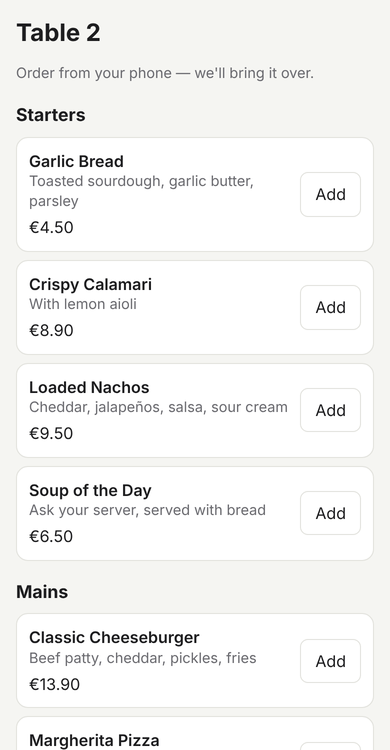
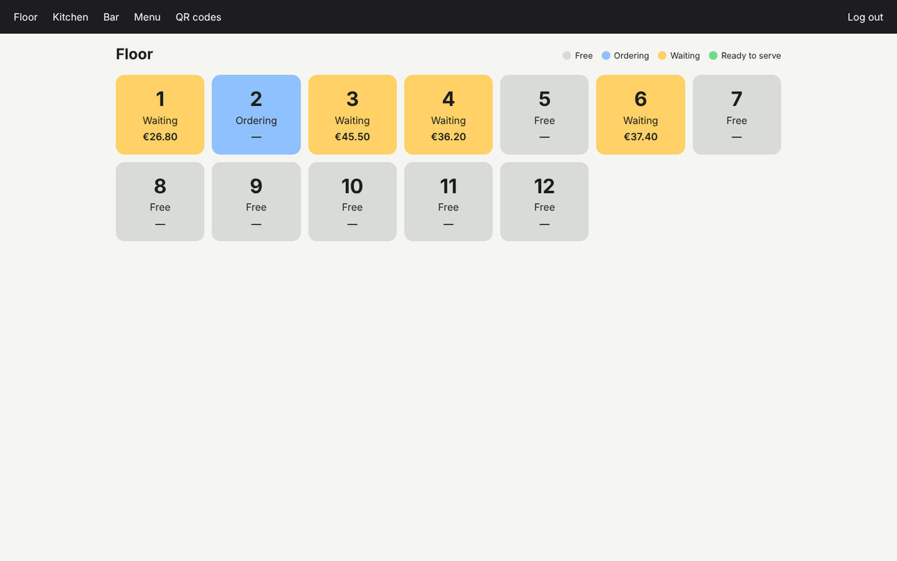
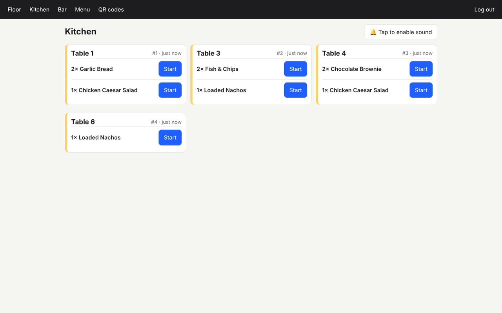
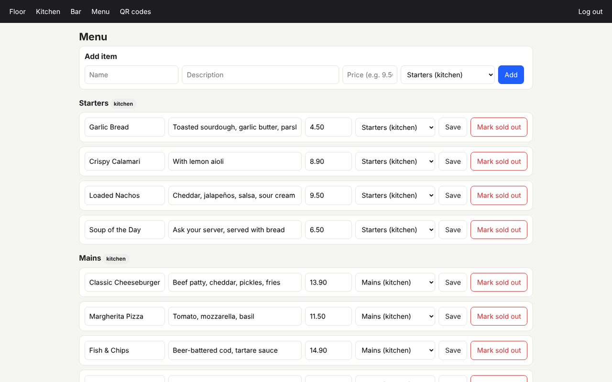

# QR Table Ordering (MVP)

Guests scan a QR code at their table, order from their phone, and the order shows up live
on the kitchen and bar screens. A manager floor view shows every table's state and open total.

Flask + Flask-SocketIO + SQLAlchemy/SQLite, server-rendered templates, vanilla JS. No build step.

## Screenshots

| Guest menu (phone) | Manager floor view |
|---|---|
|  |  |

| Kitchen screen | Menu admin |
|---|---|
|  |  |

Printable QR sheet: [`screenshots/sheet.png`](screenshots/sheet.png)

**Highlights:** live order routing over Socket.IO rooms (kitchen / bar / manager / table),
prices always taken server-side, CSRF on every staff action, PIN brute-force lockout,
per-table sessions that expire when a table is closed, 63 automated tests.

## Setup

Requires Python 3.11+.

```powershell
cd qr-ordering
python -m venv .venv
.\.venv\Scripts\Activate.ps1        # macOS/Linux: source .venv/bin/activate
pip install -r requirements.txt
python seed.py                      # 12 tables, 20 menu items
```

## Run

```powershell
$env:STAFF_PIN = "4826"                        # shared staff PIN - required, there is no default
$env:BASE_URL  = "http://192.168.1.50:5000"    # what the QR codes point to (see below)
python app.py
```

(macOS/Linux: `STAFF_PIN=4826 BASE_URL=http://192.168.1.50:5000 python app.py`)

`STAFF_PIN` must be set: without it the server refuses to start and prints
`ERROR: STAFF_PIN is not set...`. (`python seed.py` does not need it.)

Then open:

| Page | URL |
|---|---|
| Manager floor | http://localhost:5000/manager |
| Kitchen screen | http://localhost:5000/kitchen |
| Bar screen | http://localhost:5000/bar |
| Menu admin | http://localhost:5000/manager/menu |
| Printable QR sheet | http://localhost:5000/manager/qr |
| Customer page | scan a QR code, or click a link on the QR sheet (`/t/<token>`) |

Staff pages ask for the PIN once and keep a session cookie. On the kitchen/bar screens, tap
**"Tap to enable sound"** once — browsers block audio until the first tap.

### Environment variables

| Variable | Default | Purpose |
|---|---|---|
| `STAFF_PIN` | none — **required** | Shared PIN for /kitchen, /bar, /manager |
| `BASE_URL` | `http://localhost:5000` | Base of the URLs encoded in the QR codes |
| `CURRENCY` | `€` | Currency symbol shown next to prices |
| `HOST` / `PORT` | `0.0.0.0` / `5000` | Listen address |
| `SECRET_KEY` | auto-generated in `instance/secret_key` | Session cookie signing key |
| `DATABASE_URL` | `sqlite:///app.db` (in `instance/`) | SQLAlchemy database URL |

## Open it from a phone on the same Wi-Fi

1. Find this computer's LAN IP: `ipconfig` (Windows) → "IPv4 Address", e.g. `192.168.1.50`
   (macOS: `ipconfig getifaddr en0`, Linux: `hostname -I`).
2. Start the app with `BASE_URL` set to that address: `http://192.168.1.50:5000`.
   The server already listens on all interfaces (`0.0.0.0`).
3. The first time, Windows Firewall asks whether to allow Python on the network — allow it for
   **private** networks. If you missed the prompt, allow inbound TCP port 5000 manually.
4. Open `http://192.168.1.50:5000/manager/qr` on the computer and scan a code with the phone
   (or print the sheet). The phone must be on the same Wi-Fi, and the network must not isolate
   clients from each other (some guest networks do).

If the computer's IP changes, restart with the new `BASE_URL` and reprint the codes. The table
tokens themselves stay the same unless you run `python seed.py --reset`.

## Tests

```powershell
python -m pytest
```

Covers order creation and validation, station routing (HTTP and Socket.IO rooms), status
transitions, closing tables, PIN protection, the QR sheet and menu admin, plus the hardening
below (CSRF, PIN lockout, table sessions, category admin, no default PIN).

## Security notes

- **CSRF**: every staff form carries a hidden token and every staff `fetch` POST sends it in the
  `X-CSRFToken` header (read from a `<meta>` tag). Requests without a valid token get a 400.
  The guest order endpoint is exempt — guests have no login — and is authorised by the table
  token plus the table's current session id instead.
- **PIN lockout**: 5 wrong PINs from one IP address within 10 minutes lock that IP out for
  10 minutes (even the right PIN is refused, with a message saying how long is left). The
  counters live in memory, so restarting the server clears them.
- **Table sessions**: each table has a random `session_id` that changes every time the manager
  closes the table. The guest page receives it on load and sends it with each order; a page that
  was opened before the table was closed gets "This table was closed. Please rescan the QR code."
  The QR token itself never changes, so printed codes keep working.
- **Categories**: the bottom of the Menu page has add / rename / change station / delete for
  categories. A category can only be deleted once it has no items. Changing a category's station
  affects new orders only; items already ordered stay on the screen they were sent to.
- Upgrading an existing database is automatic: the `session_id` column is added on first start.

## How it works

- **Tables** are identified by a random token in the URL; there is no customer login.
- **Prices** are always read from the database when an order is placed and copied onto the order
  line (`unit_price`), so later menu edits don't change open bills. Stored as integer cents.
- **Items** move `new → preparing → ready → served`, one step at a time. Kitchen/bar do the first
  two steps, the manager marks items served. The order's status is derived from its items.
- **Table colours**: *free* → *ordering* (guest opened the page, or everything is served) →
  *waiting* (items in progress) → *ready to serve* (at least one item is ready). Closing a table
  closes its open orders and resets it to free.
- **Socket.IO rooms**: `kitchen`, `bar`, `manager`, `table:<id>`. Staff rooms require the staff
  session; a table room requires that table's token.
- Closing a table also starts a new table session (see Security notes).

## Not included (by design)

Payments, customer accounts, tips, bill splitting, multi-restaurant support, inventory,
analytics, receipt printing, deployment config. It runs on Flask's built-in server, which is fine
for a local MVP but not for the public internet.
